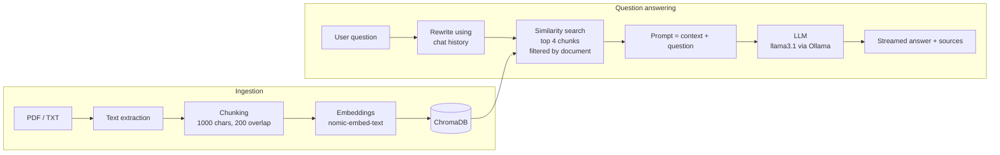

# Archive — a local RAG assistant for your documents

Ask questions about your own PDF and text files and get answers **grounded in their content**, with the exact source passages shown. Everything runs locally: the LLM and the embeddings are served by [Ollama](https://ollama.com), so no document ever leaves your machine and no API key is needed.


## Features

- **Document Q&A (RAG)**: upload a PDF or TXT file, then ask questions in natural language
- **Source citations**: every answer comes with the retrieved passages it was based on
- **Streaming answers**: responses appear token by token, as they are generated
- **Conversation memory**: follow-up questions like "give me more details on that" work, because each question is rewritten into a standalone query before retrieval
- **One conversation per document**: switch between documents without mixing their histories (persisted in the browser)
- **Document management**: list, delete and re-upload documents; re-uploading replaces the old chunks instead of duplicating them
- **100% local and private**: Ollama + ChromaDB, nothing is sent to a third-party service
- **One-command setup** with Docker Compose

## How it works



1. **Ingestion**: the uploaded file is converted to text, split into overlapping chunks, embedded with `nomic-embed-text`, and stored in ChromaDB with the file name as metadata.
2. **Retrieval**: the question is first rewritten into a standalone query using the recent chat history, then the 4 most similar chunks of the selected document are retrieved.
3. **Generation**: the chunks are injected into a prompt that tells the model to answer only from the provided context, and the answer is streamed back to the UI as newline-delimited JSON events (sources first, then tokens).

## Tech stack

| Layer | Technologies |
|---|---|
| Backend | Python, FastAPI, LangChain, pypdf |
| Vector database | ChromaDB (persistent, local) |
| LLM and embeddings | Ollama (`llama3.1`, `nomic-embed-text`) |
| Frontend | Next.js, React, TypeScript, Tailwind CSS |
| Deployment | Docker, Docker Compose |

## Getting started

### Prerequisites

- [Ollama](https://ollama.com) installed and running
- [Docker Desktop](https://www.docker.com/products/docker-desktop/) (for the Docker setup), or Python 3.12+ and Node.js 20+ (for the manual setup)

Pull the two models once:

```bash
ollama pull llama3.1
ollama pull nomic-embed-text
```

### Option 1: Docker (recommended)

```bash
git clone https://github.com/chaimjed/rag-assistant.git
cd rag-assistant
docker compose up --build
```

Then open **http://localhost:3000**.

Ollama keeps running on your machine and the containers reach it through `host.docker.internal`. If the backend reports `connection refused` towards Ollama, make it listen on all interfaces by setting the `OLLAMA_HOST` environment variable to `0.0.0.0` and restarting Ollama.

Uploaded files and the vector database are stored in Docker volumes, so they survive restarts.

### Option 2: manual setup

**Backend**

```bash
cd back
python -m venv venv
venv\Scripts\activate          # Windows
# source venv/bin/activate     # macOS / Linux
pip install -r requirements.txt
uvicorn app.main:app --reload
```

**Frontend**

```bash
cd front
npm install
npm run dev
```

The API runs on http://127.0.0.1:8000 (interactive docs at `/docs`) and the UI on http://localhost:3000.

## API

| Method | Endpoint | Description |
|---|---|---|
| `GET` | `/health` | Health check |
| `POST` | `/upload` | Upload a PDF or TXT file and index it |
| `GET` | `/documents` | List indexed documents with their chunk count |
| `DELETE` | `/documents/{filename}` | Delete a document and its chunks |
| `POST` | `/ask` | Ask a question, returns the full answer and its sources |
| `POST` | `/ask/stream` | Same as `/ask`, but streamed as NDJSON events |

Example request body for `/ask` and `/ask/stream`:

```json
{
  "question": "What is this document about?",
  "source": "my-document.pdf",
  "history": [
    { "role": "user", "content": "..." },
    { "role": "assistant", "content": "..." }
  ]
}
```

`source` restricts the search to one document, and `history` is optional.

## Project structure

```
.
├── docker-compose.yml
├── back/
│   ├── Dockerfile
│   ├── requirements.txt
│   └── app/
│       ├── main.py             # FastAPI app and CORS
│       ├── config.py           # Ollama URL and allowed origins (env vars)
│       ├── api/routes.py       # HTTP endpoints
│       ├── ingestion/          # file loading and chunking
│       ├── vectorstore/        # ChromaDB access (add, list, delete)
│       └── rag/                # retriever, query rewriting, streaming chain
└── front/
    ├── Dockerfile
    └── src/app/                # Next.js UI (chat, sources, document sidebar)
```

## Configuration

| Variable | Default | Description |
|---|---|---|
| `OLLAMA_BASE_URL` | `http://localhost:11434` | Where the backend reaches Ollama |
| `CORS_ORIGINS` | `http://localhost:3000,http://127.0.0.1:3000` | Origins allowed to call the API |
| `NEXT_PUBLIC_API_URL` | `http://127.0.0.1:8000` | API URL used by the frontend (set at build time) |

## Limitations and ideas for improvement

- Only **text-based PDFs** and `.txt` files are supported; scanned PDFs would need an OCR step
- Answer quality and speed depend on the local model: a smaller model such as `llama3.2:3b` is faster, a larger one is more accurate
- No authentication: the app is designed for single-user, local use
- Possible next steps: DOCX support, hybrid search (keyword + vectors), re-ranking, an evaluation set to measure retrieval quality

## Author

Built by [Chaima](https://github.com/chaimjed).